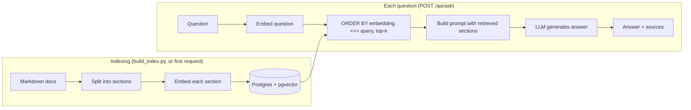

# rag-zero

**Live demo: [rag-zero.vercel.app](https://rag-zero.vercel.app/)**

A Retrieval-Augmented Generation (RAG) app over a small French knowledge base about [Mondria](https://mondria.com/), a Québec IT, cybersecurity and AI services company. I built it to learn how RAG works without a framework doing the interesting parts for me.

You ask a question. The app finds the most relevant sections of the knowledge base and an LLM answers **only** from those sections, citing them (`[MON-01-04]`). When the answer isn't in the docs, it says so instead of making it up. Questions can be in French, English or Portuguese; the answer comes back in the language of the question.

The project has two parts:

- **`api/`**: the RAG backend in Python (FastAPI). Chunking, indexing, retrieval, prompt and generation all live here. Chunks and embeddings are stored in Postgres with pgvector.
- **`web/`**: the Next.js frontend. It only renders the page and calls `POST /api/ask`.
- **`api/mcp_server.py`**: an MCP server that exposes the same knowledge base as tools to MCP clients such as Claude Code, remotely at `/api/mcp` or locally over stdio.

Both `api/` and `web/` deploy as one Vercel project through [Vercel Services](https://vercel.com/docs/services): `/api/*` goes to Python, everything else to Next.js.

## How it works



1. **Retrieval.** The question is turned into an embedding (`text-embedding-3-small` by default) and Postgres returns the 4 sections with the smallest cosine distance (`<=>`).
2. **Augmented.** Those sections become the context of the prompt, with rules: answer only from the context, cite section IDs, admit when the information isn't there.
3. **Generation.** A chat model writes the answer. The UI shows it with the documents it cites (section text, a link to the full document and to the original Mondria page), followed by the other retrieved sections and their scores.

## Design decisions

- **One chunk per section.** Each doc is split on its `## MON-xx-yy — Title` headings. One chunk covers one topic, so its embedding stays focused and the IDs double as citations. Non-content sections (`Documents associés`, `Sources`) are boundaries only.
- **Postgres + pgvector.** Each section is a row in `chunks` with an `embedding vector(1536)` column, and the search is plain SQL ordered by cosine distance (`<=>`, ascending). The primary key is (section ID, embedding model): re-indexing upserts instead of duplicating rows, and several models can coexist, so indexing one never wipes the vectors another deployment or an evaluation run is using. When cold instances start together, a Postgres advisory lock lets only the first one index; the others wait and reuse its rows. An HNSW index is there for scale: with 21 rows Postgres doesn't need it, with millions it trades a bit of recall for speed. Locally it runs in Docker (`pgvector/pgvector:pg17`); on Vercel it's Neon.
- **API embeddings instead of a local model.** My first prototype used `intfloat/multilingual-e5-small` locally, but PyTorch doesn't fit in a serverless function. The backend uses OpenAI for embeddings and generation, so the function stays small (FastAPI, httpx, psycopg, pgvector, mcp).
- **Embedding model from the environment.** `OPENAI_EMBEDDING_MODEL` picks the model. The question has to be embedded with the same model as the index, so each row stores its `embedding_model` and searches filter on it. On its first request the API checks that the table has chunks for the configured model and, if not, indexes the docs with it (one API call for 21 chunks). Other `text-embedding-3` models are asked for 1536 dimensions so the column never changes. Switching models on Vercel is a variable change and a redeploy.
- **Answer language.** With a French context, the model kept answering Portuguese questions in French. The fix was a structured response that makes the model name the question's language before writing the answer.
- **Public-demo guardrails.** The API key only exists in the Python service, questions are capped at 300 characters, `top_k` is fixed on the server and answers are capped at 500 tokens (`max_completion_tokens`), so each request has a bounded cost. A model refusal is shown as the answer instead of failing, and internal errors return a generic message. Request rate limiting isn't in the code: on Vercel it's a Firewall rate-limit rule (10 requests per minute per IP) on `/api/ask` and `/api/mcp`, plus a monthly spending cap on the OpenAI account.

## Project structure

```
api/
  mondria-rag-docs/       Knowledge base (5 Markdown files, French)
  main.py                 FastAPI app: POST /api/ask, GET /api/health, /api/mcp
  rag.py                  Chunking, indexing, retrieval, prompt and generation
  db.py                   Postgres access: schema, upsert, vector search
  schema.sql              chunks table, vector(1536) column, HNSW index
  openai_client.py        Embeddings and chat calls
  build_index.py          Indexes the docs into Postgres (idempotent)
  mcp_server.py           MCP tools (remote at /api/mcp, or stdio): search_mondria_docs, ask_mondria
  eval/questions.json     Evaluation set (29 questions)
  eval/run_eval.py        Hit rate, MRR, threshold FP/FN, citation compliance
  tests/                  pytest suite (unit, API, Postgres integration)
web/
  app/page.tsx            Demo page
  app/evaluation/page.tsx Evaluation report page
  components/ask-form.tsx Question UI, calls /api/ask
  data/evaluation.json    Saved evaluation results
vercel.json               Services: /api/* → api, the rest → web
.github/workflows/ci.yml  Tests, typecheck, lint and build on every PR
```

## Running locally

Requires Python 3.12+, [Bun](https://bun.sh/), Docker and an [OpenAI API key](https://platform.openai.com/).

**Database:**

```bash
docker run -d --name rag-db -e POSTGRES_PASSWORD=<password> -p 5433:5432 pgvector/pgvector:pg17
```

**Backend:**

```bash
python3 -m venv .venv && source .venv/bin/activate
pip install -r api/requirements.txt uvicorn python-dotenv
cd api
cp .env.example .env.local    # fill in OPENAI_API_KEY and DATABASE_URL
uvicorn main:app --reload --port 8000 --env-file .env.local
```

The API indexes the docs on its first request. To re-index after changing the docs:

```bash
set -a && source .env.local && set +a && python build_index.py
```

**Frontend**, in another terminal. In development, Next.js forwards `/api/*` to `localhost:8000`:

```bash
cd web
bun install
bun dev                       # http://localhost:3000
```

## MCP server

`api/mcp_server.py` exposes the knowledge base over the [Model Context Protocol](https://modelcontextprotocol.io/), so an AI assistant can query it on its own:

- **`search_mondria_docs(query, top_k)`**: retrieval only. Returns the closest sections with their ID, document and score; the assistant writes the answer itself and cites the IDs.
- **`ask_mondria(question)`**: the full RAG pipeline, same answer as the web demo.

The tool docstrings are what the model reads to decide when to call each tool.

**Remote (nothing to install).** The deployed API serves the same tools at `/api/mcp` over Streamable HTTP, so any MCP client that accepts a URL (Claude Code, Claude Desktop, Cursor) can connect:

```bash
claude mcp add --transport http mondria-rag https://rag-zero.vercel.app/api/mcp
```

It runs stateless with JSON responses, since on serverless any function instance may answer any request, and it shares the API's database, key and Firewall rate limit.

**Local (stdio).** The client starts `mcp_server.py` as a subprocess and talks JSON-RPC through stdin/stdout. It reads `api/.env.local` and uses your local database:

```bash
claude mcp add mondria-rag -- "$PWD/.venv/bin/python" "$PWD/api/mcp_server.py"
```

Then ask Claude Code something like "Where are Mondria's offices?" and it calls `search_mondria_docs`.

## Evaluation

`api/eval/questions.json` has 29 questions in French, English and Portuguese: 23 whose answer is in the docs (each with the section IDs that answer it) and 6 whose answer isn't (CEO, revenue, headcount, mobile apps, weather, a poutine recipe). `api/eval/run_eval.py` measures retrieval separately from the LLM, because a wrong answer can come from either step and they are fixed differently.

```bash
cd api && python eval/run_eval.py --answers --save
```

`--save` writes the results to `web/data/evaluation.json` (one entry per embedding model), which the [/evaluation page](https://rag-zero.vercel.app/evaluation) renders: metrics, model comparison, the threshold chart and every question with what was retrieved and answered. It is a committed snapshot, so visitors don't trigger API calls.

| | `text-embedding-3-small` | `text-embedding-3-large` (1536 dims) |
|---|---|---|
| hit rate@1 | 74% | 74% |
| hit rate@5 | **100%** | 96% |
| MRR | **0.837** | 0.828 |
| document hit rate@5 | 100% | 100% |
| citation error rate | **3%** | 7% |

The larger model didn't help, so the app stays on the small one. The misses have the same cause with both models: the two generic sections about the company (`MON-01-01` Identité, `MON-01-02` Positionnement) mention every service, so they rank first for broad questions. The LLM receives the top 4 sections: with the small model every expected section is among them, while with the large one two aren't (ranks 5 and below 5), and those are exactly its two citation errors.

**Citation compliance: 3% error rate (1/29) with the small model.** An answerable question passes when the answer cites an expected section; an unanswerable one passes when it cites nothing. All 6 unanswerable questions got "not available" with no citation; the one miss is an answer about Etudia without its citation. This measures citations, not factual accuracy: a wrong answer that cites the right section, or an invented one with no citation, would pass, so it complements reading the answers (they're all on the evaluation page) rather than replacing it. Answers vary slightly between runs, so a single run is a sample, not a fixed number.

**Threshold on the top-1 similarity.** Treating a low top-1 score as "not in the docs":

| threshold | false positives | false negatives | error rate |
|---|---|---|---|
| 0.30 | 5 | 0 | 17% |
| 0.35 | 4 | 0 | 14% |
| 0.45 | 2 | 5 | 24% |

A threshold only catches off-topic questions (weather 0.31, poutine 0.13). On-topic questions without an answer in the docs (CEO 0.53, headcount 0.53) score like answerable ones (lowest 0.40), so no threshold separates them: the LLM's "answer only from the context" rule is what refuses them. A threshold around 0.35 would still be useful as a cheap filter that skips the chat call for off-topic questions, with no false negatives on this set.

## Tests

```bash
cd api && pytest                                          # 31 tests, database tests skipped
TEST_DATABASE_URL=postgresql://postgres:<password>@localhost:5433/postgres pytest   # all 36
```

36 tests, under a second. They never call OpenAI: a fixture makes any real API call fail the test, and `.env.local` isn't loaded during the run.

- **Chunking**: frontmatter parsing, section boundaries (the trailing `Documents associés` and `Sources` don't leak into the last section), and the real knowledge base (21 unique sections, each with its document and source URLs).
- **RAG pipeline**: with retrieval and the chat call replaced by fakes, the model receives the question and every retrieved section, and cited sections are detected with or without brackets. With the database faked, the first request indexes an empty table, reuses existing chunks, and re-indexes when `OPENAI_EMBEDDING_MODEL` changes (the Vercel redeploy path) under the advisory lock; a failed indexing rolls back, closes the connection and leaves the instance not ready. Citations are matched as whole IDs, and a model refusal becomes the answer.
- **OpenAI client**: `text-embedding-3` models are asked for 1536 dimensions (the column size), `ada-002` isn't, vectors come back in input order; answers are capped with `max_completion_tokens`, and refusals and truncated answers raise instead of returning unparseable content.
- **API** (FastAPI `TestClient`): health check, 422 for empty or too long questions before the pipeline runs, internal errors returned as a generic 500 without leaking details, and the remote MCP endpoint answering `initialize` and `tools/list`.
- **Evaluation metrics**: hit rate, MRR, document hit rate and the false positive / negative counts on hand-made data.
- **MCP tools**: `top_k` clamping and the shape of the search results.
- **Postgres + pgvector** (integration): idempotent re-indexing, deleted sections removed, models coexisting, migration of the old single-column primary key, and results ordered by cosine distance with exact scores (1.0 and 0.707 on synthetic unit vectors). Each test runs in a temporary schema that is dropped afterwards, even when setup fails. They are skipped only when `TEST_DATABASE_URL` isn't set; with it set, a connection error fails the run instead of passing silently.

### CI

`.github/workflows/ci.yml` runs on every pull request and push to `main`: the full pytest suite against a `pgvector/pgvector:pg17` service container (so the database tests run too, with no OpenAI key), and the web app's typecheck, lint and production build.

## Deploying to Vercel

Import the repo with the Root Directory set to the repository root (where `vercel.json` is), add a Neon database from the Vercel Marketplace (it sets `DATABASE_URL`), and add `OPENAI_API_KEY`, `OPENAI_CHAT_MODEL` and, optionally, `OPENAI_EMBEDDING_MODEL` as environment variables. The first request creates the table and indexes the docs. Vercel builds `web/` and `api/` as two services behind one domain.

## About the data

The knowledge base is a factual summary of Mondria's public web pages, rewritten for this learning project. Each file lists its source URLs. This project is not affiliated with Mondria.
