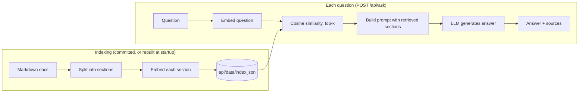

# rag-zero

**Live demo: [rag-zero.vercel.app](https://rag-zero.vercel.app/)**

A Retrieval-Augmented Generation (RAG) app over a small French knowledge base about [Mondria](https://mondria.com/), a Québec IT, cybersecurity and AI services company. I built it to learn how RAG works without a framework doing the interesting parts for me.

You ask a question. The app finds the most relevant sections of the knowledge base and an LLM answers **only** from those sections, citing them (`[MON-01-04]`). When the answer isn't in the docs, it says so instead of making it up. Questions can be in French, English or Portuguese; the answer comes back in the language of the question.

The project has two parts:

- **`api/`**: the RAG backend in Python (FastAPI). Chunking, indexing, retrieval, prompt and generation all live here.
- **`web/`**: the Next.js frontend. It only renders the page and calls `POST /api/ask`.

Both `api/` and `web/` deploy as one Vercel project through [Vercel Services](https://vercel.com/docs/services): `/api/*` goes to Python, everything else to Next.js.

## How it works



1. **Retrieval.** The question is turned into an embedding (`text-embedding-3-small` by default) and compared with the precomputed embedding of every section. The 4 closest sections win.
2. **Augmented.** Those sections become the context of the prompt, with rules: answer only from the context, cite section IDs, admit when the information isn't there.
3. **Generation.** A chat model writes the answer. The UI shows it with the documents it cites (section text, a link to the full document and to the original Mondria page), followed by the other retrieved sections and their scores.

## Design decisions

- **One chunk per section.** Each doc is split on its `## MON-xx-yy — Title` headings. One chunk covers one topic, so its embedding stays focused and the IDs double as citations. Non-content sections (`Documents associés`, `Sources`) are boundaries only.
- **Precomputed index, no vector database.** 21 chunks fit in a JSON file loaded in memory, and the search is a dot product (OpenAI embeddings are normalized, so it equals cosine similarity). At this size, a vector database would just be extra infrastructure.
- **API embeddings instead of a local model.** My first prototype used `intfloat/multilingual-e5-small` locally, but PyTorch doesn't fit in a serverless function. The backend uses OpenAI for embeddings and generation, so its only dependencies are FastAPI and httpx.
- **Embedding model from the environment.** `OPENAI_EMBEDDING_MODEL` picks the model. The question has to be embedded with the same model as the index, so at startup the API checks the model of the committed index and, if it differs, rebuilds the index in memory from the docs (one API call for 21 chunks). Switching models on Vercel is a variable change and a redeploy.
- **Answer language.** With a French context, the model kept answering Portuguese questions in French. The fix was a structured response that makes the model name the question's language before writing the answer.
- **Public-demo guardrails.** The API key only exists in the Python service, questions are capped at 300 characters and `top_k` is fixed on the server.

## Project structure

```
api/
  mondria-rag-docs/       Knowledge base (5 Markdown files, French)
  main.py                 FastAPI app: POST /api/ask, GET /api/health
  rag.py                  Retrieval, prompt and generation
  openai_client.py        Embeddings and chat calls
  build_index.py          Writes data/index.json with the configured model
  data/index.json         Precomputed embeddings
web/
  app/page.tsx            Page
  components/ask-form.tsx Question UI, calls /api/ask
vercel.json               Services: /api/* → api, the rest → web
```

## Running locally

Requires Python 3.12+, [Bun](https://bun.sh/) and an [OpenAI API key](https://platform.openai.com/).

**Backend:**

```bash
python3 -m venv .venv && source .venv/bin/activate
pip install -r api/requirements.txt uvicorn python-dotenv
cd api
cp .env.example .env.local    # fill in OPENAI_API_KEY
uvicorn main:app --reload --port 8000 --env-file .env.local
```

To rebuild the committed index after changing the docs or the embedding model (then commit `api/data/index.json`):

```bash
set -a && source .env.local && set +a && python build_index.py
```

**Frontend**, in another terminal. In development, Next.js forwards `/api/*` to `localhost:8000`:

```bash
cd web
bun install
bun dev                       # http://localhost:3000
```

## Deploying to Vercel

Import the repo with the Root Directory set to the repository root (where `vercel.json` is), and add `OPENAI_API_KEY`, `OPENAI_CHAT_MODEL` and, optionally, `OPENAI_EMBEDDING_MODEL` as environment variables. Vercel builds `web/` and `api/` as two services behind one domain.

## About the data

The knowledge base is a factual summary of Mondria's public web pages, rewritten for this learning project. Each file lists its source URLs. This project is not affiliated with Mondria.
