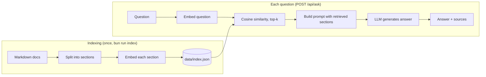

# rag-zero

A Retrieval-Augmented Generation (RAG) app over a small French knowledge base about [Mondria](https://mondria.com/), a Québec IT, cybersecurity and AI services company. I built it to learn how RAG works without a framework doing the interesting parts for me.

You ask a question. The app finds the most relevant sections of the knowledge base and an LLM answers **only** from those sections, citing them (`[MON-01-04]`). When the answer isn't in the docs, it says so instead of making it up.

The project has two parts:

- **`fastrag.py`**: a Python prototype (FastAPI + local embeddings) where I first worked out the retrieval flow.
- **`web/`**: the deployable app (Next.js on Vercel + OpenAI), with the full retrieve → augment → generate pipeline.

## How it works



1. **Retrieval.** The question is turned into an embedding (`text-embedding-3-small`) and compared with the precomputed embedding of every section. The 4 closest sections win.
2. **Augmented.** Those sections become the context of the prompt, with rules: answer only from the context, cite section IDs, admit when the information isn't there.
3. **Generation.** A chat model writes the answer. The UI shows it with the retrieved sections and their scores.

## Design decisions

- **One chunk per section.** Each doc is split on its `## MON-xx-yy — Title` headings. One chunk covers one topic, so its embedding stays focused and the IDs double as citations. Non-content sections (`Documents associés`, `Sources`) are boundaries only.
- **Precomputed index, no vector database.** 21 chunks fit in a JSON file loaded in memory, and the search is a dot product (OpenAI embeddings are normalized, so it equals cosine similarity). At this size, a vector database would just be extra infrastructure.
- **API embeddings on Vercel.** The prototype uses a local model (`intfloat/multilingual-e5-small`), but PyTorch doesn't fit in a Vercel function. The app uses OpenAI for both embeddings and generation.
- **No SDK.** The OpenAI calls are plain `fetch` against the OpenAI-compatible API, so switching to another provider (e.g. a hosted Llama) means changing the base URL and model name.
- **Public-demo guardrails.** The API key stays server-side, questions are capped at 300 characters and `top_k` is fixed on the server.

## Project structure

```
mondria-rag/            Knowledge base (5 Markdown files, French)
fastrag.py              Python prototype: retrieval only
web/
  scripts/build-index.ts  Splits the docs and writes data/index.json
  data/index.json         Precomputed embeddings
  lib/openai.ts           Embeddings and chat calls
  lib/retrieval.ts        Top-k search over the index
  lib/rag.ts              Retrieval + prompt + generation
  app/api/ask/route.ts    POST /api/ask
  components/ask-form.tsx Question UI
```

## Running the app

Requires [Bun](https://bun.sh/) and an [OpenAI API key](https://platform.openai.com/).

```bash
cd web
bun install
cp .env.example .env.local   # fill in OPENAI_API_KEY
bun run index                # embeds the docs into data/index.json
bun dev                      # http://localhost:3000
```

Run `bun run index` again whenever the docs change, and commit `data/index.json`.

**Deploying to Vercel:** import the repo, set the Root Directory to `web` and add `OPENAI_API_KEY` and `OPENAI_CHAT_MODEL` as environment variables.

## Running the Python prototype

```bash
python3 -m venv .venv && source .venv/bin/activate
pip install "fastapi[standard]" sentence-transformers
fastapi dev fastrag.py
```

```bash
curl -s localhost:8000/query -H 'Content-Type: application/json' \
  -d '{"query": "Où sont les bureaux de Mondria ?"}'
```

It returns the top-k sections with their similarity scores. There is no generation step.

## About the data

The knowledge base is a factual summary of Mondria's public web pages, rewritten for this learning project. Each file lists its source URLs. This project is not affiliated with Mondria.
