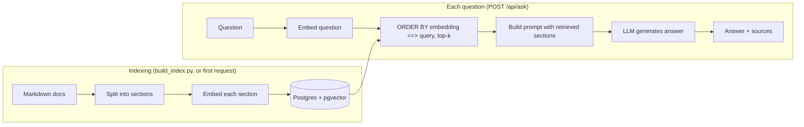

# rag-zero

**Live demo: [rag-zero.vercel.app](https://rag-zero.vercel.app/)**

A Retrieval-Augmented Generation (RAG) app over a small French knowledge base about [Mondria](https://mondria.com/), a Québec IT, cybersecurity and AI services company. I built it to learn how RAG works without a framework doing the interesting parts for me.

You ask a question. The app finds the most relevant sections of the knowledge base and an LLM answers **only** from those sections, citing them (`[MON-01-04]`). When the answer isn't in the docs, it says so instead of making it up. Questions can be in French, English or Portuguese; the answer comes back in the language of the question.

The project has two parts:

- **`api/`**: the RAG backend in Python (FastAPI). Chunking, indexing, retrieval, prompt and generation all live here. Chunks and embeddings are stored in Postgres with pgvector.
- **`web/`**: the Next.js frontend. It only renders the page and calls `POST /api/ask`.
- **`api/mcp_server.py`**: an MCP server that exposes the same knowledge base as tools to MCP clients such as Claude Code.

Both `api/` and `web/` deploy as one Vercel project through [Vercel Services](https://vercel.com/docs/services): `/api/*` goes to Python, everything else to Next.js.

## How it works



1. **Retrieval.** The question is turned into an embedding (`text-embedding-3-small` by default) and Postgres returns the 4 sections with the smallest cosine distance (`<=>`).
2. **Augmented.** Those sections become the context of the prompt, with rules: answer only from the context, cite section IDs, admit when the information isn't there.
3. **Generation.** A chat model writes the answer. The UI shows it with the documents it cites (section text, a link to the full document and to the original Mondria page), followed by the other retrieved sections and their scores.

## Design decisions

- **One chunk per section.** Each doc is split on its `## MON-xx-yy — Title` headings. One chunk covers one topic, so its embedding stays focused and the IDs double as citations. Non-content sections (`Documents associés`, `Sources`) are boundaries only.
- **Postgres + pgvector.** Each section is a row in `chunks` with an `embedding vector(1536)` column, and the search is plain SQL ordered by cosine distance (`<=>`, ascending). The section ID is the primary key, so re-indexing upserts instead of duplicating rows. An HNSW index is there for scale: with 21 rows Postgres doesn't need it, with millions it trades a bit of recall for speed. Locally it runs in Docker (`pgvector/pgvector:pg17`); on Vercel it's Neon.
- **API embeddings instead of a local model.** My first prototype used `intfloat/multilingual-e5-small` locally, but PyTorch doesn't fit in a serverless function. The backend uses OpenAI for embeddings and generation, so the function stays small (FastAPI, httpx, psycopg, pgvector).
- **Embedding model from the environment.** `OPENAI_EMBEDDING_MODEL` picks the model. The question has to be embedded with the same model as the index, so each row stores its `embedding_model`. On its first request the API checks that the table has chunks for the configured model and, if not, re-indexes the docs (one API call for 21 chunks). Other `text-embedding-3` models are asked for 1536 dimensions so the column never changes. Switching models on Vercel is a variable change and a redeploy.
- **Answer language.** With a French context, the model kept answering Portuguese questions in French. The fix was a structured response that makes the model name the question's language before writing the answer.
- **Public-demo guardrails.** The API key only exists in the Python service, questions are capped at 300 characters and `top_k` is fixed on the server.

## Project structure

```
api/
  mondria-rag-docs/       Knowledge base (5 Markdown files, French)
  main.py                 FastAPI app: POST /api/ask, GET /api/health
  rag.py                  Chunking, indexing, retrieval, prompt and generation
  db.py                   Postgres access: schema, upsert, vector search
  schema.sql              chunks table, vector(1536) column, HNSW index
  openai_client.py        Embeddings and chat calls
  build_index.py          Indexes the docs into Postgres (idempotent)
  mcp_server.py           MCP server (stdio): search_mondria_docs, ask_mondria
  eval/questions.json     Evaluation set (29 questions)
  eval/run_eval.py        Hit rate, MRR, threshold FP/FN, answer error rate
web/
  app/page.tsx            Page
  components/ask-form.tsx Question UI, calls /api/ask
vercel.json               Services: /api/* → api, the rest → web
```

## Running locally

Requires Python 3.12+, [Bun](https://bun.sh/), Docker and an [OpenAI API key](https://platform.openai.com/).

**Database:**

```bash
docker run -d --name rag-db -e POSTGRES_PASSWORD=<password> -p 5433:5432 pgvector/pgvector:pg17
```

**Backend:**

```bash
python3 -m venv .venv && source .venv/bin/activate
pip install -r api/requirements.txt uvicorn python-dotenv
cd api
cp .env.example .env.local    # fill in OPENAI_API_KEY and DATABASE_URL
uvicorn main:app --reload --port 8000 --env-file .env.local
```

The API indexes the docs on its first request. To re-index after changing the docs:

```bash
set -a && source .env.local && set +a && python build_index.py
```

**Frontend**, in another terminal. In development, Next.js forwards `/api/*` to `localhost:8000`:

```bash
cd web
bun install
bun dev                       # http://localhost:3000
```

## MCP server

`api/mcp_server.py` exposes the knowledge base over the [Model Context Protocol](https://modelcontextprotocol.io/), so an AI assistant can query it on its own:

- **`search_mondria_docs(query, top_k)`**: retrieval only. Returns the closest sections with their ID, document and score; the assistant writes the answer itself and cites the IDs.
- **`ask_mondria(question)`**: the full RAG pipeline, same answer as the web demo.

The tool docstrings are what the model reads to decide when to call each tool. The server runs over stdio: the client starts it as a subprocess and talks JSON-RPC through stdin/stdout. It reads `api/.env.local` and uses the same database as the API.

```bash
pip install -r api/requirements-dev.txt
claude mcp add mondria-rag -- "$PWD/.venv/bin/python" "$PWD/api/mcp_server.py"
```

Then ask Claude Code something like "Where are Mondria's offices?" and it calls `search_mondria_docs`.

## Evaluation

`api/eval/questions.json` has 29 questions in French, English and Portuguese: 23 whose answer is in the docs (each with the section IDs that answer it) and 6 whose answer isn't (CEO, revenue, headcount, mobile apps, weather, a poutine recipe). `api/eval/run_eval.py` measures retrieval separately from the LLM, because a wrong answer can come from either step and they are fixed differently.

```bash
cd api && python eval/run_eval.py --answers
```

| | `text-embedding-3-small` | `text-embedding-3-large` (1536 dims) |
|---|---|---|
| hit rate@1 | 74% | 74% |
| hit rate@5 | **100%** | 96% |
| MRR | **0.837** | 0.828 |
| document hit rate@5 | 100% | 100% |

The larger model didn't help, so the app stays on the small one. The misses have the same cause with both models: the two generic sections about the company (`MON-01-01` Identité, `MON-01-02` Positionnement) mention every service, so they rank first for broad questions. With k=4 the right section is still in the context, which is why the answers are right.

**Answers: 0% error rate (0/29).** Every answerable question cites an expected section, and all 6 unanswerable ones get "not available" with no citation.

**Threshold on the top-1 similarity.** Treating a low top-1 score as "not in the docs":

| threshold | false positives | false negatives | error rate |
|---|---|---|---|
| 0.30 | 5 | 0 | 17% |
| 0.35 | 4 | 0 | 14% |
| 0.45 | 2 | 5 | 24% |

A threshold only catches off-topic questions (weather 0.31, poutine 0.13). On-topic questions without an answer in the docs (CEO 0.53, headcount 0.53) score like answerable ones (lowest 0.40), so no threshold separates them: the LLM's "answer only from the context" rule is what refuses them. A threshold around 0.35 would still be useful as a cheap filter that skips the chat call for off-topic questions, with no false negatives on this set.

## Deploying to Vercel

Import the repo with the Root Directory set to the repository root (where `vercel.json` is), add a Neon database from the Vercel Marketplace (it sets `DATABASE_URL`), and add `OPENAI_API_KEY`, `OPENAI_CHAT_MODEL` and, optionally, `OPENAI_EMBEDDING_MODEL` as environment variables. The first request creates the table and indexes the docs. Vercel builds `web/` and `api/` as two services behind one domain.

## About the data

The knowledge base is a factual summary of Mondria's public web pages, rewritten for this learning project. Each file lists its source URLs. This project is not affiliated with Mondria.
