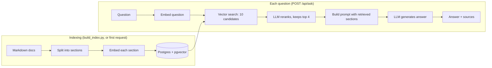

# rag-zero

**Live demo: [rag-zero.vercel.app](https://rag-zero.vercel.app/)**

A Retrieval-Augmented Generation (RAG) app over a small French knowledge base about [Mondria](https://mondria.com/), a Québec IT, cybersecurity and AI services company. I built it to learn how RAG works without a framework doing the interesting parts for me.

You ask a question. The app finds the most relevant sections of the knowledge base and an LLM answers **only** from those sections, citing them (`[MON-01-04]`). When the answer isn't in the docs, it says so instead of making it up. Questions can be in French, English or Portuguese; the answer comes back in the language of the question.

The project has two parts:

- **`api/`**: the RAG backend in Python (FastAPI). Chunking, indexing, retrieval, prompt and generation all live here. Chunks and embeddings are stored in Postgres with pgvector.
- **`web/`**: the Next.js frontend: the Mondria demo, a [/documents page](https://rag-zero.vercel.app/documents) where visitors upload their own file, and the evaluation report. It only calls the API.
- **MCP server** (`api/app/mcp.py`): exposes the same knowledge base as tools to MCP clients such as Claude Code, remotely at `/api/mcp` or locally over stdio.

The REST API is documented with Swagger at [/api/docs](https://rag-zero.vercel.app/api/docs) (ReDoc at `/api/redoc`, schema at `/api/openapi.json`).

Both `api/` and `web/` deploy as one Vercel project through [Vercel Services](https://vercel.com/docs/services): `/api/*` goes to Python, everything else to Next.js.

## How it works



1. **Retrieval.** By default (`rerank`), the question is turned into an embedding (`text-embedding-3-small`), Postgres returns the 10 sections with the smallest cosine distance (`<=>`), and the LLM reorders them by relevance; the top 4 are kept. Five other strategies can be picked per request (see below).
2. **Augmented.** Those sections become the context of the prompt, with rules: answer only from the context, cite section IDs, admit when the information isn't there.
3. **Generation.** A chat model writes the answer. The UI shows it with the documents it cites (section text, a link to the full document and to the original Mondria page), followed by the other retrieved sections and their scores.

## Design decisions

- **One chunk per section.** Each doc is split on its `## MON-xx-yy — Title` headings. One chunk covers one topic, so its embedding stays focused and the IDs double as citations. Non-content sections (`Documents associés`, `Sources`) are boundaries only.
- **Postgres + pgvector.** Each section is a row in `chunks` with an `embedding vector(1536)` column, and the search is plain SQL ordered by cosine distance (`<=>`, ascending). The primary key is (section ID, embedding model): re-indexing upserts instead of duplicating rows, and several models can coexist, so indexing one never wipes the vectors another deployment or an evaluation run is using. When cold instances start together, a Postgres advisory lock lets only the first one index; the others wait and reuse its rows. An HNSW index is there for scale: with 21 rows Postgres doesn't need it, with millions it trades a bit of recall for speed. Locally it runs in Docker (`pgvector/pgvector:pg17`); on Vercel it's Neon.
- **API embeddings instead of a local model.** My first prototype used `intfloat/multilingual-e5-small` locally, but PyTorch doesn't fit in a serverless function. The backend uses OpenAI for embeddings and generation, so the function stays small (FastAPI, httpx, psycopg, pgvector, mcp).
- **Embedding model from the environment.** `OPENAI_EMBEDDING_MODEL` picks the model. The question has to be embedded with the same model as the index, so each row stores its `embedding_model` and searches filter on it. On its first request the API checks that the table has chunks for the configured model and, if not, indexes the docs with it (one API call for 21 chunks). Other `text-embedding-3` models are asked for 1536 dimensions so the column never changes. Switching models on Vercel is a variable change and a redeploy.
- **Answer language.** With a French context, the model kept answering Portuguese questions in French. The fix was a structured response that makes the model name the question's language before writing the answer.
- **Public-demo guardrails.** The API key only exists in the Python service, questions are capped at 300 characters, `top_k` is fixed on the server and answers are capped at 500 tokens (`max_completion_tokens`), so each request has a bounded cost. A model refusal is shown as the answer instead of failing, and internal errors return a generic message. Request rate limiting isn't in the code: on Vercel it's a Firewall rate-limit rule (10 requests per minute per IP) on `/api/ask`, `/api/mcp` and `/api/documents`, plus a monthly spending cap on the OpenAI account.

## Your own documents

The [/documents page](https://rag-zero.vercel.app/documents) runs the same pipeline on a file the visitor uploads (`.md`, `.txt` or `.pdf`, up to 1 MB), while the Mondria demo stays a closed knowledge base.

- **Ingestion** (`api/app/services/ingestion.py`): text extraction (UTF-8, or `pypdf` for PDFs; scanned PDFs without text are rejected), then generic chunking: one chunk per markdown heading, and long sections or texts without headings cut into ~800-character pieces with ~150 characters of overlap, preferring paragraph and sentence boundaries. Chunks get `DOC-01-NN` IDs, so citations work exactly like the Mondria ones. Embeddings go in one batch call, and one structured chat call produces the summary, language and three suggested questions shown on the page.
- **Isolation.** Each upload gets its own collection, `upload-<128 random bits>`, stored in the same `chunks` table (the primary key is now collection, section ID and model). Only the browser that uploaded the file knows the ID, every search filters on it, and `POST /api/ask` accepts only `mondria` or a well-formed upload ID that exists. Uploads expire after 24 hours; expired rows are deleted on the next upload, so no scheduled job is needed.
- **Limits**: 1 MB, 100 chunks, three formats, generic errors for internal failures, and the Firewall rate limit. One lesson from testing: with a strict JSON schema, the model's description of a French document intermittently came back with accented letters missing or replaced by NUL characters ("employés" → "employ\u0000s"), which Postgres text columns also reject. The description now uses JSON mode with the fields validated in code, the chat client retries output that contains NUL characters, and extracted text is cleaned before being stored.

## Retrieval strategies

`api/app/services/retrieval.py` implements six ways to pick the sections, selectable per request (`strategy` in `POST /api/ask`, the MCP search tool, and a menu on the page) and measured side by side by the evaluation:

| strategy | how it works | extra cost |
|---|---|---|
| `vector` | cosine similarity in pgvector | — |
| `keyword` | Postgres full-text search (French stemming, `ts_rank_cd`, terms combined with OR) | no embedding at all |
| `hybrid` | vector + keyword lists fused with Reciprocal Rank Fusion | — |
| `mmr` | vector candidates re-picked for relevance *and* diversity (Maximal Marginal Relevance) | — |
| `multi_query` | the LLM rewrites the question in French three ways; vector search for each; RRF | 1 chat call |
| `rerank` (default) | 10 vector candidates reordered by the LLM (structured output) | 1 chat call |

## Native and LangChain

The same RAG runs in two implementations, chosen per request (`pipeline` in `POST /api/ask`, and a menu on the page): **native**, this project's own code, and **langchain**, the same strategies built from LangChain components (`api/app/services/langchain_rag.py`). Both read the same `chunks` table, use the same models and prompts, and return the same response, so the evaluation compares only the orchestration.

| strategy | LangChain component |
|---|---|
| `vector` | a custom `BaseRetriever` over the pgvector search |
| `hybrid` | `EnsembleRetriever` (vector + keyword, weighted Reciprocal Rank Fusion) |
| `multi_query` | `MultiQueryRetriever` (LLM query variants, unique union of their results) |
| `rerank` | `ContextualCompressionRetriever` + `LLMListwiseRerank` over 10 vector candidates |

Generation is an LCEL chain (`ChatPromptTemplate | ChatOpenAI.with_structured_output(..., strict=True)`). `keyword` would be the same SQL, and LangChain's MMR needs numpy and a vector store, so the LangChain pipeline doesn't offer them (422).

Choices worth explaining:
- **No `langchain-postgres`.** It needs numpy and pgvector < 0.4 and creates its own tables. Thin retrievers over the existing repository keep one schema and one index for both pipelines.
- **Async end to end.** `LLMListwiseRerank` only implements the sync path (the async one runs it in a thread), so `AsyncListwiseRerank` awaits the same chain. The LangChain models share the `OpenAIClient` connection pool, and their sync HTTP client refuses every request, so a blocking call can't slip in. Sharing the pool also means the tests' fake OpenAI transport covers LangChain.
- **Same prompts.** LangChain's default multi-query prompt keeps the question's language; it gets the native instruction (variants in the documents' language), otherwise Portuguese questions would search French documents in Portuguese.

Results (`text-embedding-3-small`, 23 answerable questions, k=5):

| strategy | hit rate@1 native · LangChain | MRR native · LangChain | citation error native · LangChain |
|---|---|---|---|
| `vector` | 74% · 74% | 0.837 · 0.837 | 3% · 7% |
| `hybrid` | 57% · 61% | 0.667 · 0.696 | 17% · 17% |
| `multi_query` | 78% · 70% | 0.870 · 0.800 | 3% · 10% |
| `rerank` | 100% · 100% | 1.000 · 1.000 | 3% · 0% |

`vector` and `rerank` match: the same search and the same kind of LLM ranking. `multi_query` loses with LangChain because `MultiQueryRetriever` returns the union of its queries' results in order, without a fusion step, so the first variant's results fill the top of the list; the native version fuses the rankings with RRF. Citation errors differ by at most two questions out of 29, which is within the noise of generation at this sample size.

## Project structure

```
api/
  mondria-rag-docs/       Knowledge base (5 Markdown files, French)
  schema.sql              chunks and uploads tables, vector(1536), HNSW and GIN indexes
  main.py                 Entrypoint for Vercel and uvicorn (main:app)
  mcp_server.py           MCP over stdio (for Claude Code)
  build_index.py          Indexes the docs into Postgres (idempotent)
  app/
    main.py               create_app(): OpenAPI, routers, error handlers, middleware, lifespan, MCP mount
    config.py             Settings (pydantic-settings): environment, then api/.env.local
    runtime.py            Settings + OpenAI client + database, opened once per process
    schemas.py            Request and response models (the Swagger documentation)
    domain.py             Internal types and constants
    errors.py             Domain exceptions and the JSON error format
    logging.py            Request ID middleware and one JSON log line per request
    mcp.py                MCP tools: search_mondria_docs, ask_mondria
    routers/              HTTP layer: ask, documents, health
    services/             rag, retrieval (six strategies), langchain_rag, indexing, ingestion (uploads)
    repositories/         SQL: connection and schema, chunks, uploads
    clients/openai.py     Embeddings and chat over httpx, as an async context manager
    clients/langchain.py  LangChain chat and embedding models sharing that connection pool
  eval/questions.json     Evaluation set (29 questions)
  eval/run_eval.py        Hit rate, MRR, threshold FP/FN, citation compliance (both pipelines)
  eval/run_ragas.py       RAGAS faithfulness and answer relevancy, context precision/recall
  tests/                  pytest suite (unit, API, golden, Postgres integration)
  ruff.toml, mypy.ini     Lint, format and strict type checking
  requirements-eval.txt   App + RAGAS, for the evaluation only (not deployed)
web/
  app/page.tsx            Demo page
  app/evaluation/page.tsx Evaluation report page
  app/documents/page.tsx  Upload a document and ask about it
  components/ask-form.tsx Question UI, calls /api/ask
  data/evaluation.json    Saved evaluation results
vercel.json               Services: /api/* → api, the rest → web
.github/workflows/ci.yml  Lint, types, tests and the web build on every PR
```

### How the API code is organized

Each layer only calls the one below it. Routers parse the request and return a response model; services hold the RAG logic and receive their dependencies as arguments; repositories run SQL on a connection the caller opens, so transactions stay in the services (indexing runs under an advisory lock, and an upload's chunks and metadata are written together). Nothing is a module-level singleton: `create_app()` opens one runtime (settings, an OpenAI client with its own `httpx` connection pool, the database state) in the FastAPI lifespan, and the MCP stdio server, the indexer and the evaluation each open their own.

- **Configuration**: `Settings` reads environment variables, then `api/.env.local`. Importing it validates nothing; each credential is required when it's used, so the health check and the tests run without an OpenAI key. Empty variables count as unset.
- **Errors**: every REST error has the same body, `{"detail": "...", "error": {"code", "message", "request_id"}}`. `detail` stays for clients that read the old format. Validation errors list the fields; unexpected errors return a generic 500 and log the stack trace with the same request ID. The MCP JSON-RPC errors and the Firewall's 429 keep their own formats.
- **Logging**: a pure ASGI middleware (it doesn't buffer uploads or the MCP stream) reuses a valid `X-Request-ID` or generates one, returns it in the response header and writes one JSON line per request with the method, the route template (`/api/documents/{collection}`, never a real collection ID), the status and the duration. Questions, documents and keys are never logged.
- **Types**: mypy in strict mode with the Pydantic plugin. Postgres rows and model JSON become typed values at the repository and client boundaries.

## Running locally

Requires Python 3.12+, [Bun](https://bun.sh/), Docker and an [OpenAI API key](https://platform.openai.com/).

**Database:**

```bash
docker run -d --name rag-db -e POSTGRES_PASSWORD=<password> -p 5433:5432 pgvector/pgvector:pg17
```

**Backend:**

```bash
python3 -m venv .venv && source .venv/bin/activate
pip install -r api/requirements.txt -r api/requirements-dev.txt uvicorn
cd api
cp .env.example .env.local    # fill in OPENAI_API_KEY and DATABASE_URL
uvicorn main:app --reload --port 8000   # Swagger at http://localhost:8000/api/docs
```

The API indexes the docs on its first request. To re-index after changing the docs:

```bash
python build_index.py
```

**Frontend**, in another terminal. In development, Next.js forwards `/api/*` to `localhost:8000`:

```bash
cd web
bun install
bun dev                       # http://localhost:3000
```

## MCP server

The MCP server (`api/app/mcp.py`) exposes the knowledge base over the [Model Context Protocol](https://modelcontextprotocol.io/), so an AI assistant can query it on its own:

- **`search_mondria_docs(query, top_k)`**: retrieval only. Returns the closest sections with their ID, document and score; the assistant writes the answer itself and cites the IDs.
- **`ask_mondria(question)`**: the full RAG pipeline, same answer as the web demo.

The tool docstrings are what the model reads to decide when to call each tool.

**Remote (nothing to install).** The deployed API serves the same tools at `/api/mcp` over Streamable HTTP, so any MCP client that accepts a URL (Claude Code, Claude Desktop, Cursor) can connect:

```bash
claude mcp add --transport http mondria-rag https://rag-zero.vercel.app/api/mcp
```

It runs stateless with JSON responses, since on serverless any function instance may answer any request, and it shares the API's database, key and Firewall rate limit.

**Local (stdio).** The client starts `mcp_server.py` as a subprocess and talks JSON-RPC through stdin/stdout. It reads `api/.env.local` and uses your local database:

```bash
claude mcp add mondria-rag -- "$PWD/.venv/bin/python" "$PWD/api/mcp_server.py"
```

Then ask Claude Code something like "Where are Mondria's offices?" and it calls `search_mondria_docs`.

## Evaluation

`api/eval/questions.json` has 29 questions in French, English and Portuguese: 23 whose answer is in the docs (each with the section IDs that answer it) and 6 whose answer isn't (CEO, revenue, headcount, mobile apps, weather, a poutine recipe). `api/eval/run_eval.py` measures retrieval separately from the LLM, because a wrong answer can come from either step and they are fixed differently.

```bash
cd api && python eval/run_eval.py --strategy all --answers --save
```

`--strategy all` runs every retrieval strategy and `--pipeline langchain` (or `all`) the LangChain implementation. `--save` writes the results to `web/data/evaluation.json` (one entry per embedding model and strategy), which the [/evaluation page](https://rag-zero.vercel.app/evaluation) renders: metrics, model comparison, the threshold chart and every question with what was retrieved and answered. It is a committed snapshot, so visitors don't trigger API calls.

**Retrieval strategies** (`text-embedding-3-small`, k = 5):

| strategy | hit rate@1 | hit rate@5 | MRR | median latency | citation error rate |
|---|---|---|---|---|---|
| `vector` | 74% | 100% | 0.837 | 336 ms | 3% |
| `keyword` | 52% | 70% | 0.591 | 0 ms | 24% |
| `hybrid` | 57% | 87% | 0.667 | 299 ms | 17% |
| `mmr` | 74% | 96% | 0.830 | 299 ms | 7% |
| `multi_query` | 78% | 100% | 0.870 | 1281 ms | 3% |
| **`rerank`** | **100%** | **100%** | **1.000** | 964 ms | 3% |

What the numbers showed:

- **Keyword search loses on a multilingual audience.** The docs are French, and French full-text search can't match Portuguese or English questions, so `keyword` misses a third of them. It still wins where embeddings struggle: "OBNL" goes from rank 4 (`vector`) to rank 1.
- **Hybrid isn't automatically better.** Fusing with equal weight, the keyword list's misses pulled the right section down: `hybrid` scored below plain `vector` here. With French-only questions the picture would likely flip.
- **Rewriting the question in French** (`multi_query`) fixes part of the language gap: best first-stage result, at the cost of a chat call.
- **Reranking fixes the "generic sections" problem.** `vector` alone puts the two broad company sections (`MON-01-01`, `MON-01-02`) first for broad questions; an LLM judging relevance does not. The first version reranked the `hybrid` candidates and was capped at 87% hit rate@5 because the right section often wasn't in that pool; switching the pool to the top 10 `vector` candidates brought it to 100% hit rate@1. That is why `rerank` is the default, for about 0.6 s and one small chat call more per question.
- 29 questions is a small set: 100% here means "no miss on these questions", not a guarantee.

**Embedding models** (`vector` strategy):

| | `text-embedding-3-small` | `text-embedding-3-large` (1536 dims) |
|---|---|---|
| hit rate@1 | 74% | 74% |
| hit rate@5 | **100%** | 96% |
| MRR | **0.837** | 0.828 |
| citation error rate | **3%** | 7% |

The larger model didn't help, so the app stays on the small one.

**Citation compliance: 3% error rate (1/29) with the default strategy.** An answerable question passes when the answer cites an expected section; an unanswerable one passes when it cites nothing. All 6 unanswerable questions got "not available" with no citation; the one miss is an answer without its citation. This measures citations, not factual accuracy: a wrong answer that cites the right section, or an invented one with no citation, would pass, so it complements reading the answers (they're all on the evaluation page) rather than replacing it. Answers vary slightly between runs, so a single run is a sample, not a fixed number.

**Threshold on the top-1 similarity** (`vector` strategy, the only one with a similarity score). Treating a low top-1 score as "not in the docs":

| threshold | false positives | false negatives | error rate |
|---|---|---|---|
| 0.30 | 5 | 0 | 17% |
| 0.35 | 4 | 0 | 14% |
| 0.45 | 2 | 5 | 24% |

A threshold only catches off-topic questions (weather 0.31, poutine 0.13). On-topic questions without an answer in the docs (CEO 0.53, headcount 0.53) score like answerable ones (lowest 0.40), so no threshold separates them: the LLM's "answer only from the context" rule is what refuses them. A threshold around 0.35 would still be useful as a cheap filter that skips the chat call for off-topic questions, with no false negatives on this set.

### RAGAS: the answers themselves

The metrics above check ranks and citations with no LLM in the loop. `api/eval/run_ragas.py` adds [RAGAS](https://docs.ragas.io/) scores for the saved answers of every run, on the 23 answerable questions (for the other 6, the right answer is a refusal, which the citation check already measures):

```bash
cd api && pip install -r requirements-eval.txt && python eval/run_ragas.py
```

- **Faithfulness**: share of the answer's claims supported by the sections it was generated from. An LLM judge splits the answer into statements and checks each one against the context. This is the hallucination measure.
- **Answer relevancy**: does the answer address the question? The judge writes questions the answer would fit, and the score is their mean cosine similarity to the real question.
- **Context precision / recall by ID**: share of the sections sent to the LLM that were expected, and share of the expected sections that were sent. No LLM; RAGAS 0.4 deprecates its ID-based metrics, so the script does the same set arithmetic.

| strategy | pipeline | faithfulness | answer relevancy | context precision | context recall |
|---|---|---|---|---|---|
| `vector` | native | 0.96 | 0.84 | 0.29 | 0.98 |
| `keyword` | native | 0.93 | 0.64 | 0.27 | 0.67 |
| `hybrid` | native | 0.86 | 0.78 | 0.23 | 0.83 |
| `mmr` | native | 0.92 | 0.81 | 0.27 | 0.91 |
| `multi_query` | native | 0.97 | 0.84 | 0.28 | 0.96 |
| `rerank` | native | 0.91 | 0.85 | 0.29 | 0.98 |
| `vector` | LangChain | 0.96 | 0.86 | 0.29 | 0.98 |
| `hybrid` | LangChain | 0.93 | 0.72 | 0.23 | 0.83 |
| `multi_query` | LangChain | 0.94 | 0.84 | 0.27 | 0.91 |
| `rerank` | LangChain | 0.95 | 0.86 | 0.29 | 0.98 |

How to read it:
- **Answer relevancy follows retrieval.** When the right section isn't retrieved (`keyword` misses a third of the questions), the model correctly says the information isn't available, and an answer that doesn't answer scores low on relevancy. Context recall shows the same thing from the retrieval side.
- **Context precision is capped by design**: 4 sections go to the LLM and most questions expect one, so 0.25 to 0.30 is near the ceiling. It would only rise by sending fewer sections.
- **Faithfulness stays above 0.85 everywhere**: the "answer only from the context" prompt holds.
- **Limits.** The judge is the same model that writes the answers (`gpt-4.1-mini`), so it may be lenient with its own style; read the scores as a comparison between configurations. With 23 questions, a few points of difference are noise, and the native and LangChain runs were generated on different days.

## Tests and checks

```bash
cd api
ruff check . && ruff format --check .
mypy
pytest                                                    # 78 tests, database tests skipped
TEST_DATABASE_URL=postgresql://postgres:<password>@localhost:5433/postgres pytest   # all 88
```

88 tests, under two seconds. They never call OpenAI: the OpenAI client is built with an `httpx` transport that fails the test on any real request, and `.env.local` isn't loaded during the run.

- **Golden end-to-end** (Postgres): the real app with a deterministic fake OpenAI, fixing the output of all six strategies, `/api/ask` and the upload. They were written before the refactoring into layers and passed unchanged after every step.
- **Chunking**: frontmatter parsing, section boundaries (the trailing `Documents associés` and `Sources` don't leak into the last section), and the real knowledge base (21 unique sections, each with its document and source URLs).
- **RAG pipeline**: with retrieval and the chat call replaced by fakes, the model receives the question and every retrieved section, and cited sections are detected with or without brackets. With the database faked, the first request indexes an empty table, reuses existing chunks, and re-indexes when `OPENAI_EMBEDDING_MODEL` changes (the Vercel redeploy path) under the advisory lock; a failed indexing rolls back, closes the connection and leaves the instance not ready. Citations are matched as whole IDs, and a model refusal becomes the answer.
- **OpenAI client**: `text-embedding-3` models are asked for 1536 dimensions (the column size), `ada-002` isn't, vectors come back in input order; answers are capped with `max_completion_tokens`, refusals and truncated answers raise instead of returning unparseable content, and output with NUL characters is retried.
- **API** (FastAPI `TestClient`): health check, 422 with the invalid fields for empty or too long questions, a generic 500 that leaks nothing and carries the same request ID in the body, header and log, request IDs reused only when valid, the route template in the access log, the OpenAPI schema, two apps running independently, and the remote MCP endpoint (`tools/list`, `tools/call`, a failing tool).
- **LangChain pipeline**: the real LangChain components against a fake OpenAI and fake repository: cosine scores kept for `vector`, RRF order for `hybrid` checked by hand, multi-query variants requested in the documents' language and deduplicated, listwise rerank order, `max_completion_tokens` and the strict schema sent, and 422 for `keyword`/`mmr`.
- **Settings**: missing and empty variables, defaults, and environment over `.env.local`.
- **Evaluation metrics**: hit rate, MRR, document hit rate and the false positive / negative counts on hand-made data.
- **Uploads**: extraction of Markdown, text and a PDF generated in the test (plus scanned, broken, too large, wrong type and non-UTF-8 files), chunking by headings and by size with overlap, the upload endpoint with fakes (private collection, NUL characters removed), collection isolation and expiry on Postgres, and 404/422 for unknown or malformed collections.
- **Retrieval strategies**: RRF ranks and scale independence, MMR dropping a near-duplicate, the LLM reranking order (unknown and repeated IDs ignored, unlisted candidates kept), the multi-query flow with fakes, and keyword search on Postgres (French stemming, short words ignored).
- **MCP tools**: `top_k` clamping and the shape of the search results.
- **Postgres + pgvector** (integration): idempotent re-indexing, deleted sections removed, models coexisting, migration of the old single-column primary key, and results ordered by cosine distance with exact scores (1.0 and 0.707 on synthetic unit vectors). Each test runs in a temporary schema that is dropped afterwards, even when setup fails. They are skipped only when `TEST_DATABASE_URL` isn't set; with it set, a connection error fails the run instead of passing silently.

### CI

`.github/workflows/ci.yml` runs on every pull request and push to `main`: Ruff (lint and format), mypy, the full pytest suite against a `pgvector/pgvector:pg17` service container (so the database tests run too, with no OpenAI key), and the web app's typecheck, lint and production build.

## Deploying to Vercel

Import the repo with the Root Directory set to the repository root (where `vercel.json` is), add a Neon database from the Vercel Marketplace (it sets `DATABASE_URL`), and add `OPENAI_API_KEY`, `OPENAI_CHAT_MODEL` and, optionally, `OPENAI_EMBEDDING_MODEL` as environment variables. The first request creates the table and indexes the docs. Vercel builds `web/` and `api/` as two services behind one domain.

## About the data

The knowledge base is a factual summary of Mondria's public web pages, rewritten for this learning project. Each file lists its source URLs. This project is not affiliated with Mondria.
